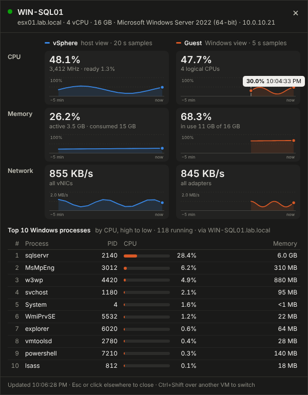
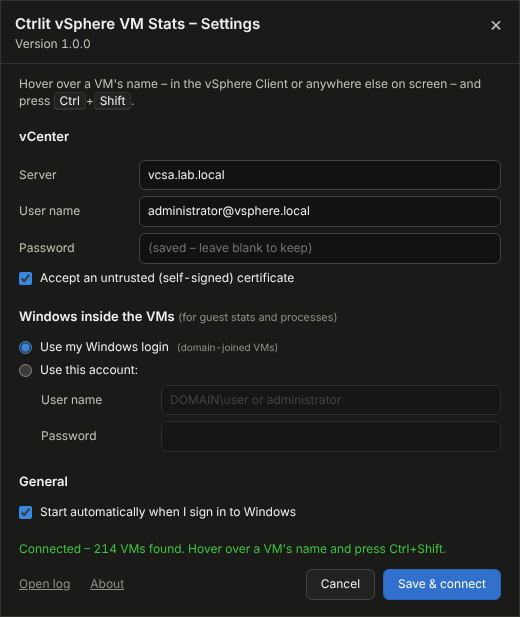

# Ctrlit vSphere VM Stats

Hover over a VM's name, in the vSphere Client or anywhere else on screen, and press **Ctrl+Shift**. A popup shows two views side by side, plus the top 10 Windows processes in the VM sorted by CPU:

- **vSphere's view** of the VM's CPU, memory and network over the last 5 minutes
- **Windows' own view** from inside the guest, for the same three measures



It's a single `.exe` that runs from the system tray. There's no installer, no runtime to install and no browser extension. It works with **vCenter** or a **standalone ESXi host**.

## Download

Get `ctrlit-vSphere-VM-Stats.exe` from the [latest release](https://github.com/ctrlittools/ctrlit-vSphere-VM-Stats/releases/latest) and double-click it. The first time, Settings opens:



- **vCenter or ESXi:** server, user name and password. A read-only account is enough. Tick "Accept an untrusted certificate" for self-signed certificates.
- **Windows inside the VMs:** use your own Windows login (for domain-joined VMs) or a specific admin account.

After that it lives in the tray. Right-click the icon for **Settings**, **Open log**, **About**, **Start with Windows** and **Exit**.

The `.exe` isn't code-signed. If Windows shows "Windows protected your PC", click **More info**, then **Run anyway**.

## What the numbers mean

| | vSphere (blue) | Guest (orange) |
|---|---|---|
| **CPU** | `cpu.usage`: CPU the VM got from the host. The subline shows MHz and **CPU ready**, the time the VM waited for a physical core. | `% Processor Time`, as Task Manager shows it |
| **Memory** | `mem.usage`: **active** memory as a % of configured RAM. The subline shows active and consumed. | **In use** (total minus available), as Task Manager shows it |
| **Network** | `net.usage`, totalled across all vNICs | Bytes/sec totalled across all adapters |

Guest memory is usually well above vSphere's "active" figure. That's normal: active only counts recently touched pages. Guest CPU running higher than vSphere CPU, together with a high ready %, usually means the host is CPU-contended.

## Requirements

- Windows 10 or 11 with the Microsoft Edge WebView2 Runtime. It's normally preinstalled; if not, the app opens the download page.
- HTTPS access to vCenter or ESXi.
- For guest stats and processes: WinRM turned on in the Windows VMs (`Enable-PSRemoting -Force`), with TCP 5985 reachable from your PC. For VMs that aren't domain-joined, use a specific account in Settings and add the VMs to TrustedHosts on your PC:
  ```powershell
  Set-Item WSMan:\localhost\Client\TrustedHosts -Value "10.0.10.*" -Concatenate -Force
  ```
  Without WinRM you still get the vSphere side. Linux VMs also show the vSphere side only.

Settings are saved to `%APPDATA%\ctrlit-vSphere-VM-Stats\config.json`. Passwords are encrypted with Windows DPAPI, so only your Windows account can read them. The log is in the same folder.

## How it works

| Piece | File | What it does |
|---|---|---|
| Hotkey and screen lookup | `app_windows.go`, `worker.ps1` | Watches for Ctrl+Shift, then uses Windows UI Automation to read the text under the mouse, plus its parent elements. That text is matched against the list of VM names. |
| vCenter / ESXi | `vcenter.go` | [govmomi](https://github.com/vmware/govmomi): keeps a cached VM name list, reads VM details and realtime (20 s) perf stats. Logs in again automatically when the session expires. |
| Windows guest | `worker.ps1`, `worker_windows.go` | A hidden PowerShell process, managed by the app, that uses CIM over WinRM to read `Win32_PerfFormattedData_*` and `Win32_OperatingSystem`, and returns the top 10 processes. |
| Popup, Settings, About | `ui.html` | Rendered with Edge WebView2 ([go-webview2](https://github.com/jchv/go-webview2)). |
| Tray, window, DPI, DPAPI, autostart | `tray_windows.go`, `winapi_windows.go`, `main_windows.go` | Plain Win32 calls. |

## Build

You need Go 1.24 or newer.

```powershell
.\build.ps1      # on Windows
```
```sh
./build.sh       # on Linux/macOS (cross-compiles)
```

Either way, the output is `dist/ctrlit-vSphere-VM-Stats.exe`. The tests run the vCenter code against govmomi's built-in vCenter and ESXi simulators, so no real vCenter or host is needed.

GitHub Actions (`.github/workflows/build.yml`) builds on every push and uploads the `.exe` as an artifact. Pushing a tag like `v1.0.0` also attaches the `.exe` to a GitHub Release.

## Support

Free and open source under the [MIT licence](LICENSE). If it saves you time, you can support it at [ko-fi.com/ctrlittools](https://ko-fi.com/ctrlittools).
